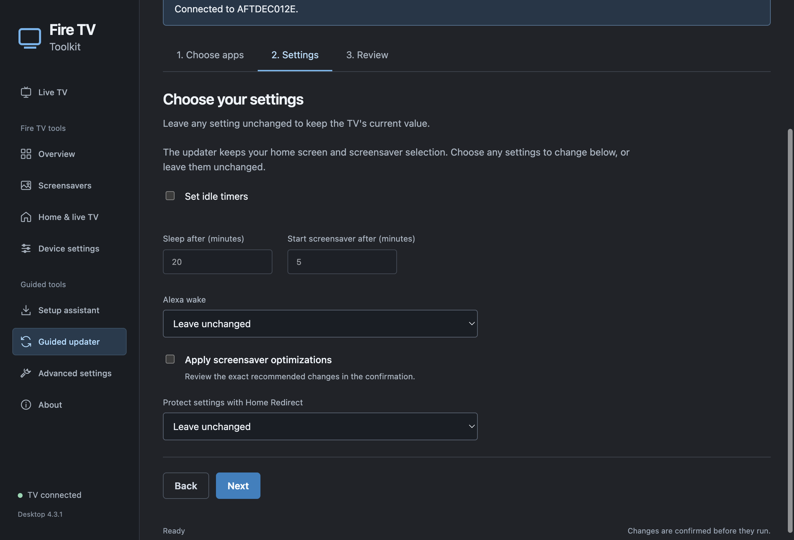

# Fire TV Toolkit desktop app

The desktop app browses the worldwide [iptv-org](https://github.com/iptv-org/iptv) catalog and plays online IPTV channels. Search channels, filter by country, language or category, save favorites, and choose another stream source when a channel has more than one. The catalog updates every twelve hours and keeps a saved copy for browsing during a catalog outage.

The Fire TV tools manage screensavers, home screens, OwnTV, Alexa wake, idle timers and protection. Connect the TV over ADB to use these controls. Guided TV changes require native confirmation, and the app reads settings back before reporting completion. Advanced shell access has a separate enable warning.

## Saved TVs

Open a TV tools page and choose **Manage TVs** to save a name and IPv4 address for each TV. Use **TV to edit** to add another TV, rename one or update its address. Choose a saved TV beside **Connect**, then connect to read that TV's settings. Selecting or saving an address does not contact or wake the TV.

The connection status shows the connected TV's name and address. Switching to another address clears the previous connection from the controls, so actions cannot continue against the previous TV. Wait for a running task to finish before switching. Each TV keeps its existing settings history under its hardware identity; names and address changes do not copy settings between TVs.

The previous saved address becomes the first profile on upgrade. Successful connections remember new addresses automatically. **Remove saved TV** removes only its address entry; its installed apps, TV settings and saved restoration data stay intact. Desktop profiles are local to this app. The CLI retains its separate saved address.

## Guided setup and updates

Fire TV UI is the recommended custom home screen and appears first in the home-screen choices. A TV with only its factory launcher starts guided setup with Fire TV UI selected for review. TVs with an installed custom launcher keep their current choice. Nothing changes until the setup confirmation is accepted.

Fire TV UI uses its own Home controls and does not require the legacy Home Redirect app. Update older Fire TV UI installations before changing Home through Toolkit. AT4K, LTvLauncher and Amazon Home remain available.

Connect your TV, then open Setup assistant. Choose a screensaver, a home screen and OwnTV, then choose any timer, Alexa, optimization or protection changes. Leave a choice unchanged to keep the existing setting. Review your selections, then approve the native confirmation. The app downloads verified releases, installs missing apps before activating them, and checks each change. If a step fails, it reports the completed changes and stops the remaining steps.

Open Guided updater to select supported apps already installed on the TV and revisit timer, Alexa, optimization or protection settings. Choices start unchanged. It downloads supported GitHub releases and verifies each APK against a published or pinned SHA-256. Apps pinned to a specific version require a toolkit update to change that version; other supported apps use their latest published release. App data is retained where Android permits. The desktop releases button opens GitHub so you can download a newer toolkit version.



## Advanced settings

Advanced settings are off by default. Enabling them opens a warning: only continue if you understand the tools and the effects of your commands. Accepting the warning reveals Activity and TV terminal. The preference is saved on this computer; turning it off hides both tools and clears their displayed session history.

Activity shows tasks and results from the current session. The TV terminal runs commands on the connected Fire TV over ADB. It shows the target address, streams standard output and errors, and reports the exit status. It does not run commands in a local computer shell. Each command starts a new TV shell, without an interactive terminal. Commands stop after sixty seconds or 256 KB of output. Stop closes the ADB session, but background tasks started by a command may continue on the TV. Commands and their output are not saved to disk by the terminal.

About explains the app, platform support, device limitations, intended use, warranty and liability terms. It includes links to the repository, Apache License 2.0 and releases, and credits Jeremy Kenedy.

## Install

The desktop build workflow produces these formats:

| System                          | Format                     | Installation                                                                                                |
| ------------------------------- | -------------------------- | ----------------------------------------------------------------------------------------------------------- |
| macOS on Intel or Apple silicon | DMG                        | Open the disk image and drag Fire TV Toolkit to Applications.                                               |
| Windows x64                     | EXE                        | Run the installer and choose the installation folder.                                                       |
| Linux x64                       | Debian package or AppImage | Install the Debian package through the system package manager, or make the AppImage executable and open it. |

Desktop packages include Electron and Google's Platform Tools 37.0.1. End users do not need Node.js, Python or a separate ADB installation. Build downloads are pinned by version and SHA-256. Installers are available from [GitHub Releases](https://github.com/jeremykenedy/fire-tv-toolkit/releases/latest). The packages are currently unsigned. Windows and macOS may ask you to verify the publisher before opening them.

## Watch IPTV

Open Live TV and choose a channel. Use the video controls to unmute or enter full screen. Choose another source when the broadcaster offers alternatives. Stream availability, regional restrictions and codec support depend on the source. HLS and formats supported by the bundled Chromium player can play in the app.

To watch on Fire TV, connect the TV and open Home & live TV. Install OwnTV, open it on the TV, and choose a remote playlist. Follow the address or QR code shown on the TV, enter its PIN, and add the worldwide playlist:

```text
https://iptv-org.github.io/iptv/index.m3u
```

Send it to the TV and start the import in OwnTV. The desktop player and Fire TV player connect directly to the online stream sources.

## Remove

On Windows, use the installed uninstaller or Windows Settings, Apps, Installed apps. The File menu can also open the uninstaller. On macOS, use File, Remove desktop app, or move the app from Applications to Trash. On Debian based Linux, remove the package with `sudo apt remove fire-tv-toolkit-desktop`. An AppImage can be deleted after closing it.

Removing the desktop application leaves TV apps and settings in place. Restore captured timers, undo optimizations, turn protection off or choose Amazon Home in the app before removing it if you want those TV changes undone. Saved device settings stay in the operating system's user application data folder, separated by device identity.

## Run and build from source

See [Signing desktop installers](SIGNING.md) for Apple Developer ID, notarization and Windows Artifact Signing setup.

Use Node.js 22.13 or newer. From the repository root:

```sh
npm ci
npm --prefix desktop ci
npm --prefix desktop run prepare:adb
npm --prefix desktop start
```

Build an installer on its target operating system:

```sh
npm --prefix desktop run dist
```

On macOS, both Intel and Apple silicon builds can be produced with `npm --prefix desktop run dist -- --mac --x64 --arm64`. The GitHub Actions desktop workflow builds all three operating systems on their own hosted runners. It stores the installers as workflow artifacts.

Run validation with:

```sh
npm test
npm --prefix desktop test
npm --prefix desktop run lint
```

The terminal commands retain their existing dependencies and supported Node.js versions. Desktop dependencies live in their own package. Run `npm --prefix desktop ci` again after changing shared toolkit code so the desktop dependency contains the current source.

Packaged application tests run on native macOS, Windows and Linux CI runners. They check catalog browsing, filters, favorite persistence, actual HLS video decoding, the bundled ADB executable, saved TV profile editing and switching, duplicate-address handling, About, advanced warning cancellation and saved preferences, and installer removal on Windows and Linux. They use a generated test broadcast and isolated application data, so they do not contact a TV.

## fire-iptv on your TV

In Home screen, choose **Install fire-iptv**. The desktop app verifies the pinned release, installs it while keeping existing app data, and opens Discover on the TV. Live TV and guide feeds are prepared automatically. Choose Add provider in the TV app for movies and series.

The setup assistant recommends fire-iptv and keeps OwnTV as an optional alternative. The update assistant includes fire-iptv when it is installed. The desktop Live TV browser remains a separate worldwide channel browser; it does not import provider credentials into the TV app.
