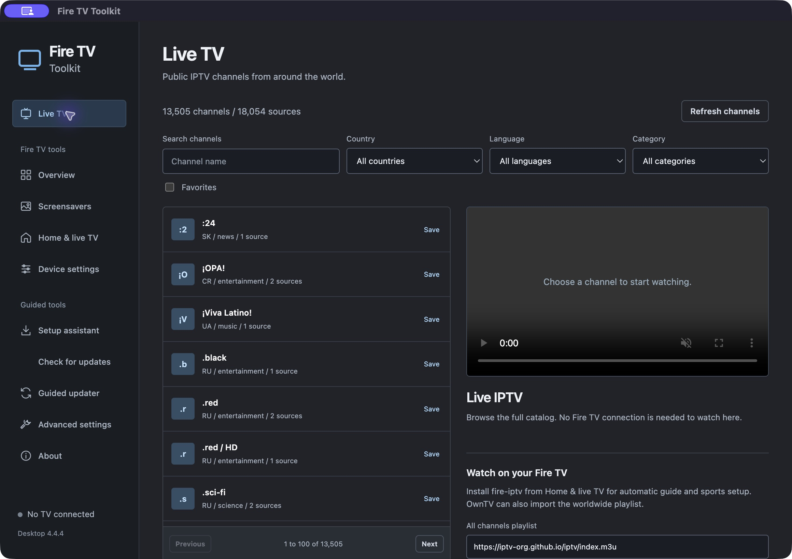
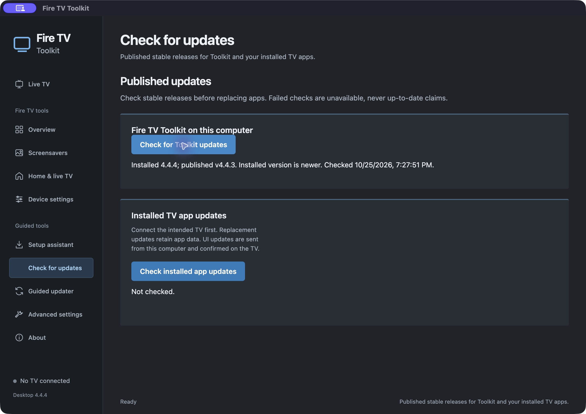
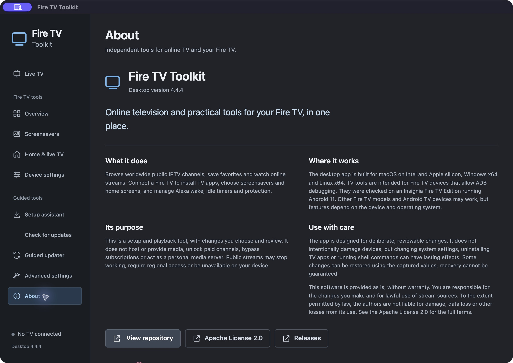
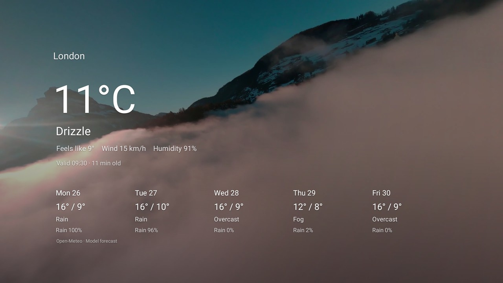
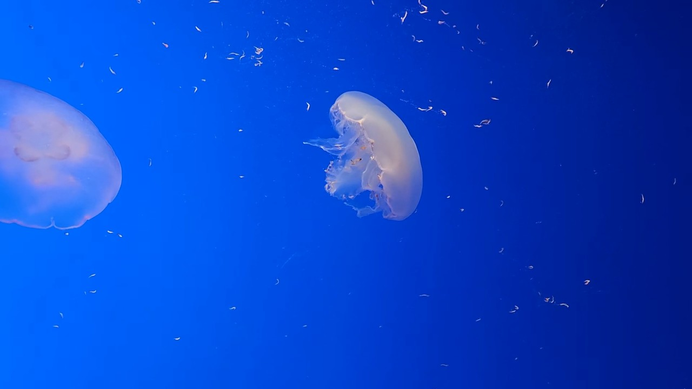

# Screenshots

[Back to the overview](../README.md)

## Desktop app

The current Live TV, update and About captures come from the actual packaged macOS 4.4.4 app. Its release check contacted GitHub and correctly reported the installed 4.4.4 candidate as newer than the published 4.4.3 release at capture time. No TV was connected and no installer was opened. [Capture provenance](../art/screenshots/desktop-4.4.4-provenance.json) records the native build and image hashes.

<table><tr>
<td></td>
<td></td>
<td></td>
</tr></table>

### Historical desktop captures

The following 4.4.1 capture records its check of 37 installed catalog apps and the correct distinction between Home Redirect's Android version and the Toolkit repository tag. It is historical evidence, not a new catalog-wide update audit.

<table><tr><td></td></tr></table>

These unchanged routes retain their historical packaged macOS 4.3.1 captures connected to a physical Fire TV.

<table>
<tr><td></td><td></td><td></td></tr>
<tr><td></td><td></td><td></td></tr>
</table>

Captured on an Insignia Fire TV Edition TV, Android TV emulators, and in macOS Terminal. Cloud Drift Clock, Jellyfish Drift, Firefly Grove, Neon Corridor, Starfield Drift, Rain on Glass, Rainforest Cascade, Blue Meridian, Twilight Hearth, Nebula Drift, Vortex Spiral, Signal Rain, Retro Flight, Pipeworks Dream, Aqua Surface Drift, Earthbound Orbit, Perseid Passage, Split-Flap Drift, Canopy Drift, Contour Flow, Skyburst Nocturne, Pulse Circuit and Helios Lightfield use screenshots from their own repositories. Select any screenshot to see it full size.

Cloud Drift Clock 2.0 uses the current unretouched physical Fire TV API 28 capture, resized for the gallery. Its filmed scene is by [anotherview](https://www.youtube.com/watch?v=kKPvF0rwqHA), licensed under [CC BY 3.0](https://creativecommons.org/licenses/by/3.0/). The source audio was omitted, the footage edited into a 34-second loop and the clock disabled for this capture. [Capture and release provenance](screenshots/candidate-sources.json) records the exact source and APK hashes.

Blue Meridian 1.0.1 uses the current physical Fire TV API 30 capture at 1920x1080. Its archival satellite imagery and modifications are documented in the [tagged upstream media guide](https://github.com/jeremykenedy/blue-meridian/blob/v1.0.1/docs/MEDIA.md).

Skycast Weather 1.0 uses an untouched physical Fire TV API28 code4 London five-day Preview, resized for this gallery. The cloud film is independent of the selected city. [Release and capture provenance](screenshots/candidate-sources.json) records the exact APK and image hashes. Film credit: anotherview, [CC BY3.0](https://creativecommons.org/licenses/by/3.0/); weather presentation: Open-Meteo, CC BY4.0 under separate service terms.

## The home screen and the on-TV picker

    <a href="screenshots/tv-at4k-home.jpg"><picture><source media="(min-width: 1280px)" srcset="screenshots/grid/tv-at4k-home-desktop.jpg 2x"><source media="(min-width: 600px)" srcset="screenshots/grid/tv-at4k-home-tablet.jpg 2x"></picture></a>
    <a href="screenshots/tv-ltv-home.jpg"><picture><source media="(min-width: 1280px)" srcset="screenshots/grid/tv-ltv-home-desktop.jpg 2x"><source media="(min-width: 600px)" srcset="screenshots/grid/tv-ltv-home-tablet.jpg 2x"></picture></a>
    <a href="screenshots/tv-at4k-screensavers-tile.jpg"><picture><source media="(min-width: 1280px)" srcset="screenshots/grid/tv-at4k-screensavers-tile-desktop.jpg 2x"><source media="(min-width: 600px)" srcset="screenshots/grid/tv-at4k-screensavers-tile-tablet.jpg 2x"></picture></a>
    <a href="screenshots/tv-screensaver-picker.jpg"><picture><source media="(min-width: 1280px)" srcset="screenshots/grid/tv-screensaver-picker-desktop.jpg 2x"><source media="(min-width: 600px)" srcset="screenshots/grid/tv-screensaver-picker-tablet.jpg 2x"></picture></a>

## Screensavers

Black Screen Dream 1.0.0 intentionally renders a completely black frame. This native capture is from its published build, also installed on Calvin's TV with the released APK hash verified.

<table><tr><td></td></tr></table>

Twilight Hearth shows actual physical Fire TV modern/bright output from its verified 1.1.0 release. See [capture provenance](screenshots/candidate-sources.json) and the [screensaver guide](SCREENSAVERS.md#twilight-hearth-11). The unchanged desktop screenshots above remain from the 4.3.1 packaged source build.

    <a href="screenshots/screensaver-aerial-views.jpg"><picture><source media="(min-width: 1280px)" srcset="screenshots/grid/screensaver-aerial-views-desktop.jpg 2x"><source media="(min-width: 600px)" srcset="screenshots/grid/screensaver-aerial-views-tablet.jpg 2x"></picture></a>
    <a href="screenshots/screensaver-aquarium-4k.jpg"><picture><source media="(min-width: 1280px)" srcset="screenshots/grid/screensaver-aquarium-4k-desktop.jpg 2x"><source media="(min-width: 600px)" srcset="screenshots/grid/screensaver-aquarium-4k-tablet.jpg 2x"></picture></a>
    <a href="screenshots/screensaver-aquarium-live.jpg"><picture><source media="(min-width: 1280px)" srcset="screenshots/grid/screensaver-aquarium-live-desktop.jpg 2x"><source media="(min-width: 600px)" srcset="screenshots/grid/screensaver-aquarium-live-tablet.jpg 2x"></picture></a>
    <a href="screenshots/screensaver-cloud-drift-clock.jpg"><picture><source media="(min-width: 1280px)" srcset="screenshots/grid/screensaver-cloud-drift-clock-desktop.jpg 2x"><source media="(min-width: 600px)" srcset="screenshots/grid/screensaver-cloud-drift-clock-tablet.jpg 2x"></picture></a>
    <a href="screenshots/screensaver-skycast-weather.jpg"><picture><source media="(min-width: 1280px)" srcset="screenshots/grid/screensaver-skycast-weather-desktop.jpg 2x"><source media="(min-width: 600px)" srcset="screenshots/grid/screensaver-skycast-weather-tablet.jpg 2x"></picture></a>
    <a href="screenshots/screensaver-prism-clock.jpg"><picture><source media="(min-width: 1280px)" srcset="screenshots/grid/screensaver-prism-clock-desktop.jpg 2x"><source media="(min-width: 600px)" srcset="screenshots/grid/screensaver-prism-clock-tablet.jpg 2x"></picture></a>
    <a href="screenshots/screensaver-perseid-passage.jpg"><picture><source media="(min-width: 1280px)" srcset="screenshots/grid/screensaver-perseid-passage-desktop.jpg 2x"><source media="(min-width: 600px)" srcset="screenshots/grid/screensaver-perseid-passage-tablet.jpg 2x"></picture></a>
    <a href="screenshots/screensaver-split-flap-drift.jpg"><picture><source media="(min-width: 1280px)" srcset="screenshots/grid/screensaver-split-flap-drift-desktop.jpg 2x"><source media="(min-width: 600px)" srcset="screenshots/grid/screensaver-split-flap-drift-tablet.jpg 2x"></picture></a>
    <a href="screenshots/screensaver-canopy-drift.jpg"><picture><source media="(min-width: 1280px)" srcset="screenshots/grid/screensaver-canopy-drift-desktop.jpg 2x"><source media="(min-width: 600px)" srcset="screenshots/grid/screensaver-canopy-drift-tablet.jpg 2x"></picture></a>
    <a href="screenshots/screensaver-contour-flow.jpg"><picture><source media="(min-width: 1280px)" srcset="screenshots/grid/screensaver-contour-flow-desktop.jpg 2x"><source media="(min-width: 600px)" srcset="screenshots/grid/screensaver-contour-flow-tablet.jpg 2x"></picture></a>
    <a href="screenshots/screensaver-skyburst-nocturne.jpg"><picture><source media="(min-width: 1280px)" srcset="screenshots/grid/screensaver-skyburst-nocturne-desktop.jpg 2x"><source media="(min-width: 600px)" srcset="screenshots/grid/screensaver-skyburst-nocturne-tablet.jpg 2x"></picture></a>
    <a href="screenshots/screensaver-pulse-circuit.jpg"><picture><source media="(min-width: 1280px)" srcset="screenshots/grid/screensaver-pulse-circuit-desktop.jpg 2x"><source media="(min-width: 600px)" srcset="screenshots/grid/screensaver-pulse-circuit-tablet.jpg 2x"></picture></a>
    <a href="screenshots/screensaver-helios-lightfield.jpg"><picture><source media="(min-width: 1280px)" srcset="screenshots/grid/screensaver-helios-lightfield-desktop.jpg 2x"><source media="(min-width: 600px)" srcset="screenshots/grid/screensaver-helios-lightfield-tablet.jpg 2x"></picture></a>
    <a href="screenshots/screensaver-jellyfish-drift.jpg"><picture><source media="(min-width: 1280px)" srcset="screenshots/grid/screensaver-jellyfish-drift-desktop.jpg 2x"><source media="(min-width: 600px)" srcset="screenshots/grid/screensaver-jellyfish-drift-tablet.jpg 2x"></picture></a>
    <a href="screenshots/screensaver-jellyfish-drift-v2.jpg"><picture><source media="(min-width: 1280px)" srcset="screenshots/grid/screensaver-jellyfish-drift-v2-desktop.jpg 2x"><source media="(min-width: 600px)" srcset="screenshots/grid/screensaver-jellyfish-drift-v2-tablet.jpg 2x"></picture></a>
    <a href="screenshots/screensaver-firefly-grove.jpg"><picture><source media="(min-width: 1280px)" srcset="screenshots/grid/screensaver-firefly-grove-desktop.jpg 2x"><source media="(min-width: 600px)" srcset="screenshots/grid/screensaver-firefly-grove-tablet.jpg 2x"></picture></a>
    <a href="screenshots/screensaver-neon-corridor.jpg"><picture><source media="(min-width: 1280px)" srcset="screenshots/grid/screensaver-neon-corridor-desktop.jpg 2x"><source media="(min-width: 600px)" srcset="screenshots/grid/screensaver-neon-corridor-tablet.jpg 2x"></picture></a>
    <a href="screenshots/screensaver-starfield-drift.jpg"><picture><source media="(min-width: 1280px)" srcset="screenshots/grid/screensaver-starfield-drift-desktop.jpg 2x"><source media="(min-width: 600px)" srcset="screenshots/grid/screensaver-starfield-drift-tablet.jpg 2x"></picture></a>
    <a href="screenshots/screensaver-rain-on-glass.jpg"><picture><source media="(min-width: 1280px)" srcset="screenshots/grid/screensaver-rain-on-glass-desktop.jpg 2x"><source media="(min-width: 600px)" srcset="screenshots/grid/screensaver-rain-on-glass-tablet.jpg 2x"></picture></a>
    <a href="screenshots/screensaver-rainforest-cascade.jpg"><picture><source media="(min-width: 1280px)" srcset="screenshots/grid/screensaver-rainforest-cascade-desktop.jpg 2x"><source media="(min-width: 600px)" srcset="screenshots/grid/screensaver-rainforest-cascade-tablet.jpg 2x"></picture></a>
    <a href="screenshots/screensaver-blue-meridian.jpg"><picture><source media="(min-width: 1280px)" srcset="screenshots/grid/screensaver-blue-meridian-desktop.jpg 2x"><source media="(min-width: 600px)" srcset="screenshots/grid/screensaver-blue-meridian-tablet.jpg 2x"></picture></a>
    <a href="screenshots/screensaver-twilight-hearth.jpg"><picture><source media="(min-width: 1280px)" srcset="screenshots/grid/screensaver-twilight-hearth-desktop.jpg 2x"><source media="(min-width: 600px)" srcset="screenshots/grid/screensaver-twilight-hearth-tablet.jpg 2x"></picture></a>
    <a href="screenshots/screensaver-nebula-drift.jpg"><picture><source media="(min-width: 1280px)" srcset="screenshots/grid/screensaver-nebula-drift-desktop.jpg 2x"><source media="(min-width: 600px)" srcset="screenshots/grid/screensaver-nebula-drift-tablet.jpg 2x"></picture></a>
    <a href="screenshots/screensaver-vortex-spiral.jpg"><picture><source media="(min-width: 1280px)" srcset="screenshots/grid/screensaver-vortex-spiral-desktop.jpg 2x"><source media="(min-width: 600px)" srcset="screenshots/grid/screensaver-vortex-spiral-tablet.jpg 2x"></picture></a>
    <a href="screenshots/screensaver-signal-rain.jpg"><picture><source media="(min-width: 1280px)" srcset="screenshots/grid/screensaver-signal-rain-desktop.jpg 2x"><source media="(min-width: 600px)" srcset="screenshots/grid/screensaver-signal-rain-tablet.jpg 2x"></picture></a>
    <a href="screenshots/screensaver-retro-flight.jpg"><picture><source media="(min-width: 1280px)" srcset="screenshots/grid/screensaver-retro-flight-desktop.jpg 2x"><source media="(min-width: 600px)" srcset="screenshots/grid/screensaver-retro-flight-tablet.jpg 2x"></picture></a>
    <a href="screenshots/screensaver-pipeworks-dream.jpg"><picture><source media="(min-width: 1280px)" srcset="screenshots/grid/screensaver-pipeworks-dream-desktop.jpg 2x"><source media="(min-width: 600px)" srcset="screenshots/grid/screensaver-pipeworks-dream-tablet.jpg 2x"></picture></a>
    <a href="screenshots/screensaver-slot-vision.jpg"><picture><source media="(min-width: 1280px)" srcset="screenshots/grid/screensaver-slot-vision-desktop.jpg 2x"><source media="(min-width: 600px)" srcset="screenshots/grid/screensaver-slot-vision-tablet.jpg 2x"></picture></a>
    <a href="screenshots/screensaver-hearth-presence.jpg"><picture><source media="(min-width: 1280px)" srcset="screenshots/grid/screensaver-hearth-presence-desktop.jpg 2x"><source media="(min-width: 600px)" srcset="screenshots/grid/screensaver-hearth-presence-tablet.jpg 2x"></picture></a>
    <a href="screenshots/screensaver-aqua-surface-drift.jpg"><picture><source media="(min-width: 1280px)" srcset="screenshots/grid/screensaver-aqua-surface-drift-desktop.jpg 2x"><source media="(min-width: 600px)" srcset="screenshots/grid/screensaver-aqua-surface-drift-tablet.jpg 2x"></picture></a>
    <a href="screenshots/screensaver-earthbound-orbit.jpg"><picture><source media="(min-width: 1280px)" srcset="screenshots/grid/screensaver-earthbound-orbit-desktop.jpg 2x"><source media="(min-width: 600px)" srcset="screenshots/grid/screensaver-earthbound-orbit-tablet.jpg 2x"></picture></a>
    <a href="screenshots/screensaver-snoozy.jpg"><picture><source media="(min-width: 1280px)" srcset="screenshots/grid/screensaver-snoozy-desktop.jpg 2x"><source media="(min-width: 600px)" srcset="screenshots/grid/screensaver-snoozy-tablet.jpg 2x"></picture></a>
    <a href="screenshots/screensaver-androsaver.jpg"><picture><source media="(min-width: 1280px)" srcset="screenshots/grid/screensaver-androsaver-desktop.jpg 2x"><source media="(min-width: 600px)" srcset="screenshots/grid/screensaver-androsaver-tablet.jpg 2x"></picture></a>
    <a href="screenshots/screensaver-colors.jpg"><picture><source media="(min-width: 1280px)" srcset="screenshots/grid/screensaver-colors-desktop.jpg 2x"><source media="(min-width: 600px)" srcset="screenshots/grid/screensaver-colors-tablet.jpg 2x"></picture></a>
    <a href="screenshots/screensaver-amazon-with-ads.jpg"><picture><source media="(min-width: 1280px)" srcset="screenshots/grid/screensaver-amazon-with-ads-desktop.jpg 2x"><source media="(min-width: 600px)" srcset="screenshots/grid/screensaver-amazon-with-ads-tablet.jpg 2x"></picture></a>

## The command line

    <a href="screenshots/cli-main-menu.jpg"><picture><source media="(min-width: 1280px)" srcset="screenshots/grid/cli-main-menu-desktop.jpg 2x"><source media="(min-width: 600px)" srcset="screenshots/grid/cli-main-menu-tablet.jpg 2x"></picture></a>
    <a href="screenshots/cli-screensavers.jpg"><picture><source media="(min-width: 1280px)" srcset="screenshots/grid/cli-screensavers-desktop.jpg 2x"><source media="(min-width: 600px)" srcset="screenshots/grid/cli-screensavers-tablet.jpg 2x"></picture></a>
    <a href="screenshots/cli-choose-screensaver.jpg"><picture><source media="(min-width: 1280px)" srcset="screenshots/grid/cli-choose-screensaver-desktop.jpg 2x"><source media="(min-width: 600px)" srcset="screenshots/grid/cli-choose-screensaver-tablet.jpg 2x"></picture></a>
    <a href="screenshots/cli-launcher.jpg"><picture><source media="(min-width: 1280px)" srcset="screenshots/grid/cli-launcher-desktop.jpg 2x"><source media="(min-width: 600px)" srcset="screenshots/grid/cli-launcher-tablet.jpg 2x"></picture></a>
    <a href="screenshots/cli-optimize.jpg"><picture><source media="(min-width: 1280px)" srcset="screenshots/grid/cli-optimize-desktop.jpg 2x"><source media="(min-width: 600px)" srcset="screenshots/grid/cli-optimize-tablet.jpg 2x"></picture></a>
    <a href="screenshots/cli-guard.jpg"><picture><source media="(min-width: 1280px)" srcset="screenshots/grid/cli-guard-desktop.jpg 2x"><source media="(min-width: 600px)" srcset="screenshots/grid/cli-guard-tablet.jpg 2x"></picture></a>
    <a href="screenshots/cli-timeouts.jpg"><picture><source media="(min-width: 1280px)" srcset="screenshots/grid/cli-timeouts-desktop.jpg 2x"><source media="(min-width: 600px)" srcset="screenshots/grid/cli-timeouts-tablet.jpg 2x"></picture></a>
    <a href="screenshots/cli-timeouts-current.jpg"><picture><source media="(min-width: 1280px)" srcset="screenshots/grid/cli-timeouts-current-desktop.jpg 2x"><source media="(min-width: 600px)" srcset="screenshots/grid/cli-timeouts-current-tablet.jpg 2x"></picture></a>
    <a href="screenshots/cli-revert.jpg"><picture><source media="(min-width: 1280px)" srcset="screenshots/grid/cli-revert-desktop.jpg 2x"><source media="(min-width: 600px)" srcset="screenshots/grid/cli-revert-tablet.jpg 2x"></picture></a>
    <a href="screenshots/cli-info.jpg"><picture><source media="(min-width: 1280px)" srcset="screenshots/grid/cli-info-desktop.jpg 2x"><source media="(min-width: 600px)" srcset="screenshots/grid/cli-info-tablet.jpg 2x"></picture></a>

